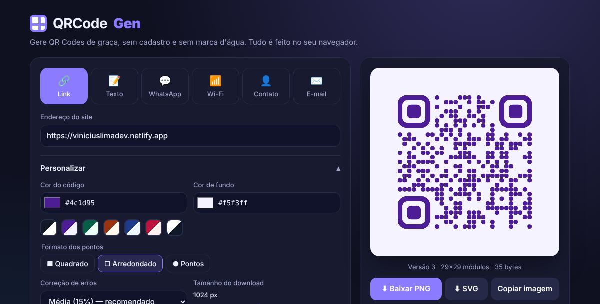

# QRCodeGen — Gerador de QR Code

Gere QR Codes de links, textos, Wi-Fi, WhatsApp, e-mail e contatos, personalize as cores e baixe a imagem.

🔗 **[Ver o site no ar](https://iamviniciuslima05.github.io/PROJETO-QRCodeGen/)**



## Funcionalidades

- QR Code de **link, texto, WhatsApp, Wi-Fi, contato (vCard) e e-mail**
- Gerador de QR Code **escrito do zero** em JavaScript, sem bibliotecas
- **Cores** personalizadas e combinações prontas
- Pontos **quadrados, arredondados ou redondos**
- 4 níveis de **correção de erros**
- Download em **PNG** (até 2048 px) e **SVG**
- Aviso quando o **contraste** está baixo
- **Histórico** dos últimos códigos

## Tecnologias

HTML5 · CSS3 · JavaScript · Canvas · SVG · localStorage

## Estrutura

```
index.html
css/style.css
js/qr.js       → gerador de QR Code (Reed-Solomon, máscaras)
js/script.js   → interface
```

## Como rodar

Não precisa instalar nada: baixe o projeto e abra o `index.html` no navegador, ou acesse a versão publicada acima.

---
Feito por **Vinicius Lima** · [Portfólio](https://viniciuslimadev.netlify.app) · [LinkedIn](https://www.linkedin.com/in/viniciuslima25/)
